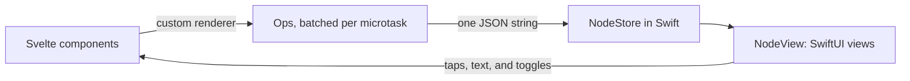

<div align="center">


<h1>swiftui-svelte</h1>

<p><strong>Build iOS apps with Svelte 5, rendered as native SwiftUI views.</strong></p>

<p>
<a href="https://www.npmjs.com/package/swiftui-svelte"></a>
<a href="https://github.com/firatciftci/swiftui-svelte/actions/workflows/ci.yml"></a>
<a href="#requirements"></a>
<a href="./LICENSE"></a>
</p>

<p>
<a href="#quick-start">Quick start</a>
·
<a href="#documentation">Documentation</a>
·
<a href="docs/reference.md">Elements</a>
·
<a href="#how-it-works">How it works</a>
·
<a href="docs/performance.md">Performance</a>
·
<a href="#known-gaps">Known gaps</a>
</p>

</div>

<p align="center">
  <picture>
    <source media="(prefers-color-scheme: dark)" srcset=".github/assets/screens-dark.webp">
    
  </picture>
</p>

```svelte
<script lang="ts">
  const todos = $state([{ title: "Render Svelte with SwiftUI", done: true }]);
  let draft = $state("");

  function add() {
    todos.push({ title: draft, done: false });
    draft = "";
  }
</script>

<navstack>
  <screen title="To-dos">
    <list>
      <hstack>
        <textfield
          placeholder="New to-do"
          value={draft}
          oninput={(value) => (draft = value)}
          onsubmit={add}
        />
        <btn variant="prominent" onclick={add}>Add</btn>
      </hstack>
      {#each todos as todo, index (index)}
        <toggle
          checked={todo.done}
          onchange={(checked) => (todo.done = checked)}
        >
          {todo.title}
        </toggle>
      {/each}
    </list>
  </screen>
</navstack>
```

That component is a real `NavigationStack` with a `List`, a `TextField`, a `Button`, and a `Toggle` for each to-do. There is no web view: Svelte runs in JavaScriptCore, and every element on the screen is a SwiftUI view, with the scrolling, gestures, Dynamic Type, dark mode, and accessibility that come with it.

> [!NOTE]
> swiftui-svelte is an early release, built on Svelte's experimental [custom renderer API](https://svelte.dev/docs/svelte/custom-renderers). The elements cover what the example app needs, and the API may change between 0.x releases.

## Features

- **Native controls.** Lists, forms, pickers, sliders, date pickers, navigation stacks, tab views, search fields, sheets, alerts, toolbars, and swipe actions are the SwiftUI views themselves.
- **Plain Svelte 5.** Runes, components, `{#if}`, `{#each}`, and shared `.svelte.ts` state all work as they do on the web.
- **Typed elements.** Every element and attribute is typed, so `svelte-check` catches a misspelled attribute or a wrong value before you build.
- **Small updates.** Svelte sends only what changed, and SwiftUI re-renders only the views that changed.
- **Web APIs.** `fetch`, `WebSocket`, `URL`, `crypto`, `localStorage`, `matchMedia`, and the other browser APIs that npm packages expect are built in. They are backed by `URLSession`, CryptoKit, and `UserDefaults`, so most web code runs unchanged.
- **Native modules and components.** Call your own Swift functions from Svelte as async functions, and register SwiftUI views, such as a MapKit map, as new elements. Haptics, the clipboard, the share sheet, links, the Keychain, and app files are built in.
- **Live reload.** In the simulator, the app reloads as soon as Vite rebuilds the bundle, without a rebuild in Xcode.

## Requirements

| Side           | Needs                                              |
| -------------- | -------------------------------------------------- |
| The Svelte app | Svelte 5.59 (`~5.59.0`) and Vite 7 or later        |
| The iOS app    | iOS 18 or later, and Xcode 26 or later to build it |

Svelte's custom renderer API is experimental and can change in a minor release, so the package only accepts the Svelte 5.59 releases it's been tested with. CI runs the tests on Svelte 5.59.0, the first release with the custom renderer API, and on the newest 5.59 release. A new release of swiftui-svelte will widen the range once a newer Svelte is tested.

## Quick start

The quickest start is a new app from the template:

```sh
npx swiftui-svelte create my-app
cd my-app
npm install
npm run build
open ios/MyApp.xcodeproj
```

The template has a Svelte app with TypeScript, ESLint, and the presets below, and an Xcode project that depends on the Swift package. A build phase in the Xcode project bundles the JavaScript for Release builds, and for any build that doesn't have a bundle yet. Run `npm run dev` while you work, and the app in the simulator reloads each time you save. Use `npm run serve` for an app on a device. It starts Vite's dev server.

To add swiftui-svelte to an app you already have, follow [Getting started](docs/getting-started.md).

## Documentation

- [Getting started](docs/getting-started.md): create an app from the template, or add swiftui-svelte to an app you already have.
- [Element reference](docs/reference.md): every element and modifier, with the type of each attribute and an example.
- [Elements](docs/elements.md): how the elements behave, from rich text, colors, and shapes to bindable components, refs and focus, transitions, presentations, and accessibility.
- [Navigation](docs/navigation.md): navigation stacks and search.
- [Forms](docs/forms.md): settings screens and sign-up forms, with text fields, keyboards, focus, and validation.
- [Loading data](docs/loading-data.md): requests with loading and error states, pull to refresh, paging, saved data, and WebSockets.
- [Device environment, lifecycle, and localization](docs/environment.md): the device's settings, app lifecycle events, deep links, restoring state, and translations.
- [Web APIs](docs/web-apis.md): `fetch`, `WebSocket`, `localStorage`, and the other browser APIs that the app provides.
- [Native modules and components](docs/native-modules.md): calling Swift from JavaScript, the built-in modules, and SwiftUI views as new elements.
- [Embedding in a Swift app](docs/embedding.md): props, actions, several components in one bundle, and views that share one runtime.
- [Tailwind CSS](docs/tailwind.md): applying Tailwind utility classes to elements, the variants for dark mode and window width, and which utilities have a native equivalent.
- [Performance](docs/performance.md): keeping the app fast, and how to measure it on a device.
- [Debugging](docs/debugging.md): live reload, logging, Safari's Web Inspector, errors, and common problems.
- [Releasing to the App Store](docs/app-store.md): release builds, versions, privacy, and testing before you submit.

The example app shows every element in its Catalog tab.

## How it works



1. [`src/renderer.ts`](src/renderer.ts) is a Svelte custom renderer. It keeps a lightweight node tree in JavaScript, because Svelte needs to read it synchronously, and tracks which nodes Swift already has. Swift only gets the nodes that are attached to the screen: Svelte's comment anchors, whitespace-only text, and nodes that are still being built stay in JavaScript.
2. Changes are batched per microtask into one flat JSON array of numbers and values. A new subtree goes over in a single `insert`, with its attributes and children inline, and element and attribute names are sent once and then referred to by number. The other ops are `move`, `remove`, `attr`, `unattr`, and `text`. Within a batch, a node that's added and removed again is never sent, and an attribute or text that changes several times is sent once, with its last value.
3. `SvelteView` runs the bundle in JavaScriptCore on its own serial queue, off the main thread. `NodeStore` reads each batch with a small UTF-8 scanner instead of `Codable`, mirrors the tree as `@Observable` nodes, and `NodeView` turns each node into a SwiftUI view: `vstack` becomes a `VStack`, `btn` becomes a `Button`, and so on. Only the nodes that change are re-rendered.
4. Native events go back through `__svelteDispatch`, which calls the handlers that Svelte registered. Taps, timers, network callbacks, and animation frames don't block the main thread: JavaScript handles them on its queue, and Swift applies the resulting changes on the main thread as they arrive. Text input, toggles, pickers, navigation, and new props wait for JavaScript to finish, so if the handler rejects a control's new value, the control changes back before the next frame.
5. When Svelte removes a subtree, Swift drops it and all of its descendants right away, so Swift never holds nodes that aren't on screen.
6. The first commit carries the version of the bridge protocol. If the bundle was built with a release of swiftui-svelte that doesn't match the app's SvelteSwiftUI package, `SvelteView` shows a version mismatch screen instead of rendering a broken tree.

## Known gaps

- **No `bind:` on elements.** `bind:` works on the components in `swiftui-svelte/components`, but Svelte doesn't allow it on elements in custom renderer components, so elements are controlled: pass `value` and update it in `oninput`. The control always ends up showing your state. If the handler trims the text, rejects a character, or ignores a toggle, the native control changes back to match, so you can use `oninput={(value) => (name = value.slice(0, 12))}` as a length limit. Update the state synchronously in the handler, because the control reverts to whatever the state holds once the handler returns. A `textfield` with no `value` keeps whatever the user types.
- **`checked` arrives as a string.** Svelte sends `checked` as `""` or removes it, the way it handles HTML boolean attributes, instead of passing the boolean through ([sveltejs/svelte#19435](https://github.com/sveltejs/svelte/issues/19435)). The host accepts both that and a real boolean, in case [#19437](https://github.com/sveltejs/svelte/pull/19437) is merged.
- **Large lists take a few frames.** Svelte's work happens off the main thread, but SwiftUI still needs several frames to lay out 1,000 new rows.
- **Slow keyed reverses.** In Svelte 5.59, reversing a keyed `{#each}` takes time proportional to the square of its length ([sveltejs/svelte#19439](https://github.com/sveltejs/svelte/issues/19439)). With the fix in [#19440](https://github.com/sveltejs/svelte/pull/19440), reversing 1,000 rows on the iPhone takes about 21ms in Svelte's part, down from 122ms, and the longest frame falls from about 140ms to about 70ms.
- **Removal transitions in lists.** Inside a `list` row, the row resizes on its own when an element leaves, so a removal transition there can look abrupt.

## Example app

[`example/`](example) has a demo with four tabs: a to-do list with navigation, swipe to delete, and storage that survives relaunches; a catalog with an example of every element and modifier, the same examples that the [element reference](docs/reference.md) shows; a playground with a counter, a text field, a sheet, and a request to GitHub; and a settings form with segmented, menu, and navigation pickers, a slider, a stepper, a time picker, and a progress bar that tracks the to-dos you've finished. The screenshots at the top come from it. [CONTRIBUTING.md](CONTRIBUTING.md) explains how to run it.

## Contributing

Bug reports, fixes, and new elements are welcome. See [CONTRIBUTING.md](CONTRIBUTING.md) to get set up, and [SECURITY.md](SECURITY.md) to report a vulnerability.

## License

[MIT](LICENSE)
