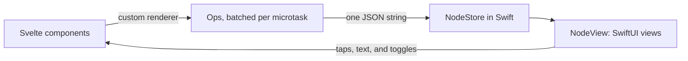

<div align="center">


<h1>swiftui-svelte</h1>

<p><strong>Build iOS apps with Svelte 5, rendered as native SwiftUI views.</strong></p>

<p>
<a href="https://www.npmjs.com/package/swiftui-svelte"></a>
<a href="https://github.com/firatciftci/swiftui-svelte/actions/workflows/ci.yml"></a>
<a href="#requirements"></a>
<a href="./LICENSE"></a>
</p>

<p>
<a href="#quick-start">Quick start</a>
·
<a href="#elements">Elements</a>
·
<a href="#navigation">Navigation</a>
·
<a href="#how-it-works">How it works</a>
·
<a href="#performance">Performance</a>
·
<a href="#known-gaps">Known gaps</a>
</p>

</div>

<p align="center">
  <picture>
    <source media="(prefers-color-scheme: dark)" srcset=".github/assets/screens-dark.webp">
    
  </picture>
</p>

```svelte
<script lang="ts">
  const todos = $state([{ title: "Render Svelte with SwiftUI", done: true }]);
  let draft = $state("");

  function add() {
    todos.push({ title: draft, done: false });
    draft = "";
  }
</script>

<navstack>
  <screen title="To-dos">
    <list>
      <hstack>
        <textfield
          placeholder="New to-do"
          value={draft}
          oninput={(value) => (draft = value)}
          onsubmit={add}
        />
        <btn variant="prominent" onclick={add}>Add</btn>
      </hstack>
      {#each todos as todo, index (index)}
        <toggle
          checked={todo.done}
          onchange={(checked) => (todo.done = checked)}
        >
          {todo.title}
        </toggle>
      {/each}
    </list>
  </screen>
</navstack>
```

That component is a real `NavigationStack` with a `List`, a `TextField`, a `Button`, and a `Toggle` for each to-do. There is no web view: Svelte runs in JavaScriptCore, and every element on the screen is a SwiftUI view, with the scrolling, gestures, Dynamic Type, dark mode, and accessibility that come with it.

> [!NOTE]
> swiftui-svelte is an early release, built on Svelte's experimental [custom renderer API](https://svelte.dev/docs/svelte/custom-renderers). The elements cover what the example app needs, and the API may change between 0.x releases.

## Features

- **Native controls.** Lists, forms, pickers, sliders, date pickers, navigation stacks, tab views, sheets, alerts, toolbars, and swipe actions are the SwiftUI views themselves.
- **Plain Svelte 5.** Runes, components, `{#if}`, `{#each}`, and shared `.svelte.ts` state all work as they do on the web.
- **Typed elements.** Every element and attribute is typed, so `svelte-check` catches a misspelled attribute or a wrong value before you build.
- **Small updates.** Svelte sends only what changed, and SwiftUI re-renders only the views that changed.
- **`fetch` and `localStorage`.** Network requests go through `URLSession`, and `localStorage` is saved in `UserDefaults`, so most web code that uses them runs unchanged.
- **Live reload.** In the simulator, the app reloads as soon as Vite rebuilds the bundle, without a rebuild in Xcode.

## Requirements

| Side           | Needs                                              |
| -------------- | -------------------------------------------------- |
| The Svelte app | Svelte 5.59 (`~5.59.1`) and Vite 7 or later        |
| The iOS app    | iOS 18 or later, and Xcode 26 or later to build it |

Svelte's custom renderer API is experimental and can change in a minor release, so the package only accepts the Svelte 5.59 releases it's been tested with. A new release of swiftui-svelte will widen the range once a newer Svelte is tested.

## Quick start

### 1. Set up the Svelte app

Install the package alongside Svelte and Vite:

```sh
npm install -D swiftui-svelte svelte vite @sveltejs/vite-plugin-svelte
```

Point the Svelte compiler at the renderer in `svelte.config.js`:

```js
export default {
  compilerOptions: {
    experimental: { customRenderer: "swiftui-svelte/renderer" },
  },
};
```

Add the Vite plugin, which bundles the app into the single file that the iOS app loads:

```ts
import { svelte } from "@sveltejs/vite-plugin-svelte";
import { defineConfig } from "vite";
import { swiftui } from "swiftui-svelte/vite";

export default defineConfig({
  plugins: [
    svelte(),
    swiftui({ entry: "src/main.ts", outFile: "ios/MyApp/Resources/app.js" }),
  ],
});
```

Mount your root component in `src/main.ts`:

```ts
import { mountApp } from "swiftui-svelte";
import App from "./App.svelte";

mountApp(App);
```

Finally, add `"swiftui-svelte/elements"` to `compilerOptions.types` in `tsconfig.json`, so `svelte-check` knows the elements and their attributes. Run `vite build` to write `app.js`.

### 2. Show it in the iOS app

In Xcode, choose **File › Add Package Dependencies**, enter `https://github.com/firatciftci/swiftui-svelte`, and add the `SvelteSwiftUI` library to your app target. Add `app.js` to the app's resources, then show it with `SvelteView`:

```swift
import SvelteSwiftUI
import SwiftUI

@main
struct MyApp: App {
    var body: some Scene {
        WindowGroup {
            SvelteView(source: Bundle.main.bundleURL.appending(path: "app.js"))
        }
    }
}
```

> [!TIP]
> For live reload, pass `reloadsOnChange: true` and, in the simulator, point `source` at the `app.js` in your source tree instead of the bundled copy. Then run `vite build --watch`, and the app reloads each time you save. [`SvelteHostApp.swift`](example/ios/SvelteHost/SvelteHostApp.swift) in the example shows how.

To debug the JavaScript, open Safari's **Develop** menu and pick the "Svelte" context under your simulator or device. This works in Debug builds.

## Elements

The elements and their attributes are typed in [`src/elements.ts`](src/elements.ts).

| Element                        | SwiftUI                        | Attributes and events                                                           |
| ------------------------------ | ------------------------------ | ------------------------------------------------------------------------------- |
| `navstack`                     | `NavigationStack`              | `onpop(depth)`                                                                  |
| `screen`                       | A screen in the stack          | `title`                                                                         |
| `tabview`, `tab`               | `TabView`, a tab               | `title`, `symbol` (on `tab`)                                                    |
| `vstack`, `hstack`             | `VStack`, `HStack`             | `spacing`, `alignment`                                                          |
| `zstack`, `scrollview`, `list` | `ZStack`, `ScrollView`, `List` |                                                                                 |
| `txt`                          | `Text`                         | `lines`, `align`                                                                |
| `btn`                          | `Button`                       | `variant`, `role`, `onclick`                                                    |
| `sfsymbol`                     | `Image(systemName:)`           | `name`, `label`                                                                 |
| `asyncimage`                   | `AsyncImage`                   | `src`, `fit`                                                                    |
| `textfield`                    | `TextField`                    | `value`, `placeholder`, `oninput(value)`, `onsubmit`                            |
| `toggle`                       | `Toggle`                       | `checked`, `onchange(checked)`                                                  |
| `formview`, `sectionview`      | `Form`, `Section`              | `header`, `footer` (on `sectionview`)                                           |
| `picker`, `choice`             | `Picker` and its options       | `label`, `value`, `variant`, `onchange(value)`; `value`, `symbol` (on `choice`) |
| `slider`                       | `Slider`                       | `value`, `min`, `max`, `step`, `oninput(value)`, `onchange(value)`              |
| `stepper`                      | `Stepper`                      | `value`, `min`, `max`, `step`, `onchange(value)`                                |
| `datepicker`                   | `DatePicker`                   | `value`, `min`, `max`, `components`, `variant`, `onchange(date)`                |
| `progressview`                 | `ProgressView`                 | `value`, `total`                                                                |
| `spacer`, `divider`            | `Spacer`, `Divider`            |                                                                                 |
| `sheet`                        | `.sheet`                       | `detent`, `ondismiss`                                                           |
| `alert`                        | `.alert`                       | `title`, `ondismiss`                                                            |
| `toolbar`                      | `.toolbar`                     | `placement`                                                                     |
| `swipeactions`                 | `.swipeActions`                | `edge`                                                                          |

Every element also accepts these modifiers:

| Modifier                      | What it does                                                                                          |
| ----------------------------- | ----------------------------------------------------------------------------------------------------- |
| `padding`                     | Pads the element by a number of points, or by 16 points when `padding` is written as a bare attribute |
| `width`, `height`             | Sets a fixed size                                                                                     |
| `font`, `weight`              | Sets the text style, such as `headline` or `caption`, and the weight                                  |
| `color`, `tint`, `background` | Colors the content, the controls, or the background                                                   |
| `radius`, `opacity`           | Rounds the corners and sets the opacity                                                               |
| `animated`                    | Animates children as they're added, removed, or reordered                                             |

A few details:

- **Buttons.** `variant` is `automatic`, `borderless`, `bordered`, or `prominent`, and `role` is `destructive` or `cancel`. With `variant="automatic"`, a button in a list makes its whole row tappable.
- **Text.** `lines` caps the number of lines, and `align` sets the alignment of wrapped text: `leading`, `center`, or `trailing`.
- **Images.** `asyncimage` shows a spinner while the image loads, then scales it to fit its frame, or to fill it with `fit="fill"`. Give it a `width` and `height`.
- **Symbols.** Without a `label`, VoiceOver reads an `sfsymbol` with SwiftUI's built-in description of the symbol. Set `label` to say what the icon does, especially on icon-only buttons: `<sfsymbol name="trash" label="Delete to-do" />`.
- **Forms.** `formview` gives a screen the grouped look of the Settings app. Group its rows with `sectionview`, which shows an optional `header` above the rows and `footer` below them. `sectionview` works inside a `list` too.
- **Pickers.** Each `choice` is one option: its text is the title, its `value` is what `onchange` receives, and `symbol` adds an SF Symbol. `variant` is `automatic`, `menu`, `segmented`, `wheel`, `inline`, or `navigation`. With `navigation`, the options open on their own screen, so the picker has to be inside a `navstack`.
- **Sliders and steppers.** A `slider` goes from `min` to `max`, which default to 0 and 1, and snaps to multiples of `step` when you set it. `oninput` fires while the user drags, and `onchange` fires when they let go. A `stepper` changes `value` by `step`, 1 by default, and stays between `min` and `max` if you set them.
- **Dates.** A `datepicker` takes a `Date` or an ISO 8601 string for `value`, `min`, and `max`, and `onchange` receives a `Date`. `components` is `date`, `time`, or `datetime`, the default. `variant` is `automatic`, `compact`, `graphical`, or `wheel`.
- **Progress.** A `progressview` shows a bar filled to `value` out of `total`, which defaults to 1, or a spinner when there's no `value`. Its children are its label.
- **Attribute values.** Attributes reach Swift as JSON, so `null`, booleans, numbers, strings, arrays, and objects keep their types, and functions are never sent. A `Date` becomes an ISO 8601 string, a `BigInt` becomes a number, a `Map` becomes an object, and a `Set` becomes an array. `NaN`, `Infinity`, and `undefined` inside arrays become `null`, and `undefined` properties are dropped. An attribute set to `null` or `undefined` is removed. Where an element expects a number, a numeric string like `spacing="8"` works too. Where it expects a string, a number or boolean is converted. Where it expects a boolean (like `checked` or `animated`), the values `false`, `0`, `null`, and `"false"` are false, and anything else, including the empty string of a bare attribute, is true.
- **Names.** `txt`, `btn`, `sfsymbol`, `formview`, `sectionview`, and `progressview` have these names because `text`, `button`, `image`, `symbol`, `form`, `section`, and `progress` are already HTML and SVG elements in `svelte/elements`, and their types can't be overridden.

### Sheets, alerts, toolbars, and swipe actions

These four elements aren't drawn where they appear. Instead, they attach to the element around them, the way their SwiftUI modifiers do:

- A `sheet` or an `alert` inside a `screen` is presented for as long as it's rendered, so you show and hide it with `{#if}`. When the user dismisses it, `ondismiss` fires so you can update your state. An `alert` uses its `txt` children as the message and its `btn` children as the actions.
- A `toolbar` inside a `screen` puts its children in the navigation bar, or in the bottom bar with `placement="bottom"`.
- A `swipeactions` inside a list row adds its buttons as the row's swipe actions.

```svelte
<script lang="ts">
  let items: Array<string> = $state(["Milk", "Eggs"]);
  let confirming = $state(false);
</script>

<navstack>
  <screen title="Groceries">
    <list>
      {#each items as item (item)}
        <txt>{item}</txt>
      {/each}
    </list>

    <toolbar>
      <btn onclick={() => (confirming = true)}>Clear</btn>
    </toolbar>

    {#if confirming}
      <alert title="Clear the list?" ondismiss={() => (confirming = false)}>
        <txt>This can't be undone.</txt>
        <btn role="cancel" onclick={() => (confirming = false)}>Cancel</btn>
        <btn role="destructive" onclick={() => (items = [])}>Clear</btn>
      </alert>
    {/if}
  </screen>
</navstack>
```

## Navigation

Svelte owns the navigation stack. The first `screen` in a `navstack` is the root, and every `screen` after it is pushed on top, so you push a screen by rendering another one, usually from an `{#each}` over a state array. When the user taps the back button or swipes back, `onpop` receives the number of pushed screens that are left, and your app trims its array to match:

```svelte
<script lang="ts">
  let stack: Array<number> = $state([]);
</script>

<navstack onpop={(depth) => (stack.length = depth)}>
  <screen title="To-dos">
    <!-- a button that calls stack.push(todo.id) -->
  </screen>

  {#each stack as id, depth (depth)}
    <TodoDetail {id} onclose={() => (stack.length = depth)} />
  {/each}
</navstack>
```

Each pushed screen is a regular component, so it's mounted when it's pushed and destroyed when it's popped. Removing a screen from the array pops it with the usual animation. In the example app, the to-do list and its detail screens share state through [`todos.svelte.ts`](example/src/todos.svelte.ts).

## Networking and storage

The host provides `fetch` and `localStorage`, so this runs as it would in a browser:

```ts
async function loadRepo(): Promise<void> {
  const response = await fetch("https://api.github.com/repos/sveltejs/svelte");
  const repo: unknown = await response.json();
  localStorage.setItem("repo", JSON.stringify(repo));
}
```

`fetch` goes through `URLSession`. It takes a `method`, `headers`, and a string `body`, and the response has `ok`, `status`, `headers`, `text()`, and `json()`. `localStorage` is saved in `UserDefaults`, so it survives relaunches. The host also provides `setTimeout`, `setInterval`, `queueMicrotask`, and `console`, which prints to Xcode's console.

## How it works



1. [`src/renderer.ts`](src/renderer.ts) is a Svelte custom renderer. It keeps a lightweight node tree in JavaScript, because Svelte needs to read it synchronously, and tracks which nodes Swift already has. Swift only gets the nodes that are attached to the screen: Svelte's comment anchors, whitespace-only text, and nodes that are still being built stay in JavaScript.
2. Changes are batched per microtask into one flat JSON array of numbers and values. A new subtree goes over in a single `insert`, with its attributes and children inline, and element and attribute names are sent once and then referred to by number. The other ops are `move`, `remove`, `attr`, `unattr`, and `text`. Within a batch, a node that's added and removed again is never sent, and an attribute or text that changes several times is sent once, with its last value.
3. `SvelteView` runs the bundle in JavaScriptCore. `NodeStore` reads each batch with a small UTF-8 scanner instead of `Codable`, mirrors the tree as `@Observable` nodes, and `NodeView` turns each node into a SwiftUI view: `vstack` becomes a `VStack`, `btn` becomes a `Button`, and so on. Only the nodes that change are re-rendered.
4. Native events go back through `__svelteDispatch`, which calls the handlers that Svelte registered.
5. When Svelte removes a subtree, Swift drops it and all of its descendants right away, so Swift never holds nodes that aren't on screen.
6. The first commit carries the version of the bridge protocol. If the bundle was built with a release of swiftui-svelte that doesn't match the app's SvelteSwiftUI package, `SvelteView` shows a version mismatch screen instead of rendering a broken tree.

## Performance

On an iPhone 17 Pro, with a Release build, over two runs of the benchmark on a list of 1,000 rows:

| Scenario           | Svelte          | Swift   | Longest frame |
| ------------------ | --------------- | ------- | ------------- |
| Create 1,000 rows  | 79ms            | 28–31ms | 129–140ms     |
| Update all labels  | 24–33ms         | 3ms     | 33–36ms       |
| Update one label   | 1ms             | 0.1ms   | 17ms          |
| Reverse            | 122ms           | 1ms     | 139–142ms     |
| Clear              | 9–15ms          | 3–17ms  | 38–52ms       |
| Keystroke (median) | 0.6–0.9ms total |         | 52ms          |

"Svelte" is the time Svelte spent updating its tree, "Swift" is the time Swift spent decoding and applying the ops, and "Longest frame" includes SwiftUI's own rendering. Updates to a few nodes, like a keystroke or a single label, fit within a frame. Creating or reversing 1,000 rows at once blocks a few frames, mostly in Svelte's part.

The table above was measured with version 0.2.0. Since then, the bridge sends only what's on screen, in the compact encoding described in [How it works](#how-it-works). In an iPhone 18 Pro simulator with the JIT off and a Debug build, creating 1,000 rows now takes Swift 4ms instead of 37ms, with 1,004 ops instead of 30,008 and a 67 KB payload instead of 1.4 MB. Clearing them takes Swift under 1ms instead of 7ms.

Released nodes are cleaned up on both sides: after 6,000 rows were created and cleared, 13 nodes were still alive in JavaScript, and Swift held only the 7 nodes on screen.

<details>
<summary>Running the benchmark</summary>

`pnpm bench` builds [`Bench.svelte`](example/src/Bench.svelte) instead of the example app. It runs a fixed set of scenarios on a 1,000-row `list` (create, update all, update one, toggle all, reverse, append one, simulated typing, clear, and a loop that creates and clears rows and checks that nodes get released) and logs one `BENCH` line per scenario to the console. Run `pnpm build` afterward to get the example app back. Benchmark a Release build, because Debug builds of the Swift side are several times slower.

To sign for a device, create `example/ios/Local.xcconfig`, which git ignores, with your team ID and a bundle ID that's free on your account:

```xcconfig
DEVELOPMENT_TEAM = YOUR_TEAM_ID
PRODUCT_BUNDLE_IDENTIFIER[sdk=iphoneos*] = com.yourname.SvelteHost
```

Then build, install, and launch with the console attached. `xcrun devicectl list devices` shows the device ID.

```sh
pnpm bench
pnpm ios:project
xcodebuild -project example/ios/SvelteHost.xcodeproj -scheme SvelteHost -configuration Release \
  -destination 'id=DEVICE_ID' -derivedDataPath example/ios/build -allowProvisioningUpdates build
xcrun devicectl device install app --device DEVICE_ID example/ios/build/Build/Products/Release-iphoneos/SvelteHost.app
xcrun devicectl device process launch --console --terminate-existing --device DEVICE_ID com.yourname.SvelteHost
```

Apps on iOS devices run JavaScriptCore without its JIT compiler, but the simulator has it. To get closer to device numbers in the simulator, launch with the JIT turned off:

```sh
SIMCTL_CHILD_JSC_useJIT=false xcrun simctl launch --console-pty --terminate-running-process booted com.example.SvelteHost
```

With the JIT off, an iPhone 18 Pro simulator came within about 1.5 times the device numbers: Svelte took 64ms to create 1,000 rows and 82ms to reverse them, and Swift's times were about the same as on the device.

</details>

## Known gaps

- **No `bind:`.** Svelte doesn't allow `bind:` on elements in custom renderer components, so inputs are controlled: pass `value` and update it in `oninput`.
- **`checked` arrives as a string.** Svelte sends `checked` as `""` or removes it, the way it handles HTML boolean attributes, instead of passing the boolean through ([sveltejs/svelte#19435](https://github.com/sveltejs/svelte/issues/19435)). The host accepts both that and a real boolean, in case [#19437](https://github.com/sveltejs/svelte/pull/19437) is merged.
- **One thread.** JavaScript runs on the main thread, so large updates, like creating or reversing 1,000 rows, block a few frames.
- **Slow keyed reverses.** In Svelte 5.59, reversing a keyed `{#each}` takes time proportional to the square of its length ([sveltejs/svelte#19439](https://github.com/sveltejs/svelte/issues/19439)). With the fix in [#19440](https://github.com/sveltejs/svelte/pull/19440), reversing 1,000 rows on the iPhone takes about 21ms in Svelte's part, down from 122ms, and the longest frame falls from about 140ms to about 70ms.
- **Limited animation.** Animation is limited to `animated` on containers. There are no transitions, custom animations, or gestures beyond taps and swipes.

## Example app

[`example/`](example) has a demo with three tabs: a to-do list with navigation, swipe to delete, and storage that survives relaunches; a playground with a counter, a text field, a sheet, and a request to GitHub; and a settings form with segmented, menu, and navigation pickers, a slider, a stepper, a time picker, and a progress bar that tracks the to-dos you've finished. The screenshots at the top come from it. [CONTRIBUTING.md](CONTRIBUTING.md) explains how to run it.

## Contributing

Bug reports, fixes, and new elements are welcome. See [CONTRIBUTING.md](CONTRIBUTING.md) to get set up, and [SECURITY.md](SECURITY.md) to report a vulnerability.

## License

[MIT](LICENSE)
