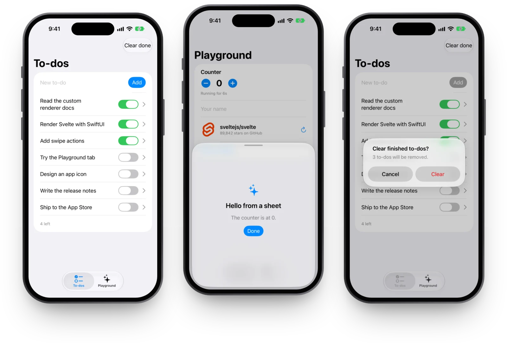
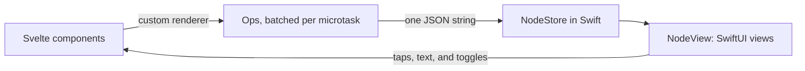

<div align="center">


<h1>swiftui-svelte</h1>

<p><strong>Build iOS apps with Svelte 5, rendered as native SwiftUI views.</strong></p>

<p>
<a href="https://www.npmjs.com/package/swiftui-svelte"></a>
<a href="https://github.com/firatciftci/swiftui-svelte/actions/workflows/ci.yml"></a>
<a href="#requirements"></a>
<a href="./LICENSE"></a>
</p>

<p>
<a href="#quick-start">Quick start</a>
·
<a href="#elements">Elements</a>
·
<a href="#navigation">Navigation</a>
·
<a href="#how-it-works">How it works</a>
·
<a href="#performance">Performance</a>
·
<a href="#known-gaps">Known gaps</a>
</p>

</div>

<p align="center">
  <picture>
    <source media="(prefers-color-scheme: dark)" srcset=".github/assets/screens-dark.webp">
    
  </picture>
</p>

```svelte
<script lang="ts">
  const todos = $state([{ title: "Render Svelte with SwiftUI", done: true }]);
  let draft = $state("");

  function add() {
    todos.push({ title: draft, done: false });
    draft = "";
  }
</script>

<navstack>
  <screen title="To-dos">
    <list>
      <hstack>
        <textfield
          placeholder="New to-do"
          value={draft}
          oninput={(value) => (draft = value)}
          onsubmit={add}
        />
        <btn variant="prominent" onclick={add}>Add</btn>
      </hstack>
      {#each todos as todo, index (index)}
        <toggle
          checked={todo.done}
          onchange={(checked) => (todo.done = checked)}
        >
          {todo.title}
        </toggle>
      {/each}
    </list>
  </screen>
</navstack>
```

That component is a real `NavigationStack` with a `List`, a `TextField`, a `Button`, and a `Toggle` for each to-do. There is no web view: Svelte runs in JavaScriptCore, and every element on the screen is a SwiftUI view, with the scrolling, gestures, Dynamic Type, dark mode, and accessibility that come with it.

> [!NOTE]
> swiftui-svelte is an early release, built on Svelte's experimental [custom renderer API](https://svelte.dev/docs/svelte/custom-renderers). The elements cover what the example app needs, and the API may change between 0.x releases.

## Features

- **Native controls.** Lists, forms, pickers, sliders, date pickers, navigation stacks, tab views, sheets, alerts, toolbars, and swipe actions are the SwiftUI views themselves.
- **Plain Svelte 5.** Runes, components, `{#if}`, `{#each}`, and shared `.svelte.ts` state all work as they do on the web.
- **Typed elements.** Every element and attribute is typed, so `svelte-check` catches a misspelled attribute or a wrong value before you build.
- **Small updates.** Svelte sends only what changed, and SwiftUI re-renders only the views that changed.
- **Web APIs.** `fetch`, `WebSocket`, `URL`, `crypto`, `localStorage`, `matchMedia`, and the other browser APIs that npm packages expect are built in. They are backed by `URLSession`, CryptoKit, and `UserDefaults`, so most web code runs unchanged.
- **Live reload.** In the simulator, the app reloads as soon as Vite rebuilds the bundle, without a rebuild in Xcode.

## Requirements

| Side           | Needs                                              |
| -------------- | -------------------------------------------------- |
| The Svelte app | Svelte 5.59 (`~5.59.1`) and Vite 7 or later        |
| The iOS app    | iOS 18 or later, and Xcode 26 or later to build it |

Svelte's custom renderer API is experimental and can change in a minor release, so the package only accepts the Svelte 5.59 releases it's been tested with. A new release of swiftui-svelte will widen the range once a newer Svelte is tested.

## Quick start

### 1. Set up the Svelte app

Install the package alongside Svelte and Vite:

```sh
npm install -D swiftui-svelte svelte vite @sveltejs/vite-plugin-svelte
```

Point the Svelte compiler at the renderer in `svelte.config.js`:

```js
export default {
  compilerOptions: {
    experimental: { customRenderer: "swiftui-svelte/renderer" },
  },
};
```

Add the Vite plugin, which bundles the app into the single file that the iOS app loads:

```ts
import { svelte } from "@sveltejs/vite-plugin-svelte";
import { defineConfig } from "vite";
import { swiftui } from "swiftui-svelte/vite";

export default defineConfig({
  plugins: [
    svelte(),
    swiftui({ entry: "src/main.ts", outFile: "ios/MyApp/Resources/app.js" }),
  ],
});
```

Register your root component in `src/main.ts`:

```ts
import { mountApp } from "swiftui-svelte";
import App from "./App.svelte";

mountApp(App);
```

Finally, add `"swiftui-svelte/elements"` to `compilerOptions.types` in `tsconfig.json`, so `svelte-check` knows the elements and their attributes. Run `vite build` to write `app.js`.

### 2. Show it in the iOS app

In Xcode, choose **File › Add Package Dependencies**, enter `https://github.com/firatciftci/swiftui-svelte`, and add the `SvelteSwiftUI` library to your app target. Add `app.js` to the app's resources, then show it with `SvelteView`:

```swift
import SvelteSwiftUI
import SwiftUI

@main
struct MyApp: App {
    var body: some Scene {
        WindowGroup {
            SvelteView(source: Bundle.main.bundleURL.appending(path: "app.js"))
        }
    }
}
```

> [!TIP]
> For live reload, pass `reloadsOnChange: true` and, in the simulator, point `source` at the `app.js` in your source tree instead of the bundled copy. Then run `vite build --watch`, and the app reloads each time you save. [`SvelteHostApp.swift`](example/ios/SvelteHost/SvelteHostApp.swift) in the example shows how.

To debug the JavaScript, open Safari's **Develop** menu and pick the "Svelte" context under your simulator or device. This works in Debug builds.

When the JavaScript throws, Debug builds show the error over your app, with the message, the file and line in your Svelte or TypeScript source, and the stack trace. **Reload** restarts the bundle, and **Dismiss** hides the error and leaves the app as it was. The `swiftui()` Vite plugin writes `app.js.map` next to `app.js`, and `SvelteView` uses it to turn bundle positions into source positions, so add both files to your app target. Release builds don't show the overlay: they print the error to the console and keep the last screen that rendered.

## Elements

The elements and their attributes are typed in [`src/elements.ts`](src/elements.ts).

| Element                             | SwiftUI                             | Attributes and events                                                           |
| ----------------------------------- | ----------------------------------- | ------------------------------------------------------------------------------- |
| `navstack`                          | `NavigationStack`                   | `onpop(depth)`                                                                  |
| `screen`                            | A screen in the stack               | `title`                                                                         |
| `tabview`, `tab`                    | `TabView`, a tab                    | `selection`, `onchange(selection)`; `title`, `symbol`, `value` (on `tab`)       |
| `vstack`, `hstack`                  | `VStack`, `HStack`                  | `spacing`, `alignment`                                                          |
| `zstack`                            | `ZStack`                            | `alignment`                                                                     |
| `scrollview`, `list`                | `ScrollView`, `List`                |                                                                                 |
| `lazyvstack`, `lazyhstack`          | `LazyVStack`, `LazyHStack`          | `spacing`, `alignment`, `pinned`                                                |
| `lazyvgrid`, `lazyhgrid`            | `LazyVGrid`, `LazyHGrid`            | `columns` or `rows`, `spacing`, `alignment`, `pinned`                           |
| `grid`, `gridrow`                   | `Grid`, `GridRow`                   | `alignment`, `spacing`, `hspacing`, `vspacing`; `alignment` (on `gridrow`)      |
| `viewthatfits`                      | `ViewThatFits`                      | `axes`                                                                          |
| `group`, `groupbox`, `controlgroup` | `Group`, `GroupBox`, `ControlGroup` | `title` (on `groupbox` and `controlgroup`)                                      |
| `disclosuregroup`                   | `DisclosureGroup`                   | `title`, `expanded`, `ontoggle(expanded)`                                       |
| `txt`                               | `Text`                              | `lines`, `align`, `truncation`, `minscale`, `selectable`, `markdown`, and more  |
| `btn`                               | `Button`                            | `variant`, `role`, `onclick`                                                    |
| `sfsymbol`                          | `Image(systemName:)`                | `name`, `label`                                                                 |
| `asyncimage`                        | `AsyncImage`                        | `src`, `fit`                                                                    |
| `textfield`                         | `TextField`                         | `value`, `placeholder`, `debounce`, `oninput(value)`, `onsubmit`                |
| `toggle`                            | `Toggle`                            | `checked`, `onchange(checked)`                                                  |
| `formview`, `sectionview`           | `Form`, `Section`                   | `header`, `footer` (on `sectionview`)                                           |
| `picker`, `choice`                  | `Picker` and its options            | `label`, `value`, `variant`, `onchange(value)`; `value`, `symbol` (on `choice`) |
| `slider`                            | `Slider`                            | `value`, `min`, `max`, `step`, `oninput(value)`, `onchange(value)`              |
| `stepper`                           | `Stepper`                           | `value`, `min`, `max`, `step`, `onchange(value)`                                |
| `datepicker`                        | `DatePicker`                        | `value`, `min`, `max`, `components`, `variant`, `onchange(date)`                |
| `progressview`                      | `ProgressView`                      | `value`, `total`                                                                |
| `spacer`, `divider`                 | `Spacer`, `Divider`                 | `minlength` (on `spacer`)                                                       |
| `sheet`                             | `.sheet`                            | `detent`, `ondismiss`                                                           |
| `alert`                             | `.alert`                            | `title`, `ondismiss`                                                            |
| `toolbar`                           | `.toolbar`                          | `placement`                                                                     |
| `swipeactions`                      | `.swipeActions`                     | `edge`                                                                          |

Every element also accepts these modifiers:

| Modifier                           | What it does                                                                                          |
| ---------------------------------- | ----------------------------------------------------------------------------------------------------- |
| `padding`                          | Pads the element by a number of points, or by 16 points when `padding` is written as a bare attribute |
| `width`, `height`                  | Sets a fixed size                                                                                     |
| `font`, `size`, `design`, `weight` | Sets the text style or a fixed size, the design, and the weight                                       |
| `color`, `tint`, `background`      | Colors the content, the controls, or the background                                                   |
| `radius`, `opacity`                | Rounds the corners and sets the opacity                                                               |
| `animated`, `animation`            | Animates children as they're added, removed, or reordered, with the curve from `animation`            |
| `lang`, `dir`                      | Sets the locale and the layout direction (`ltr` or `rtl`) for the element and everything inside it    |

A few details:

- **Buttons.** `variant` is `automatic`, `borderless`, `bordered`, or `prominent`, and `role` is `destructive` or `cancel`. With `variant="automatic"`, a button in a list makes its whole row tappable.
- **Stacks.** `alignment` takes any of SwiftUI's alignment guides. On a `vstack` that's `leading`, `center`, `trailing`, `listRowSeparatorLeading`, or `listRowSeparatorTrailing`. On an `hstack` it's `top`, `center`, `bottom`, `firstTextBaseline`, or `lastTextBaseline`, which lines up text of different sizes. A `zstack` takes a corner or edge such as `topLeading`, or a baseline alignment such as `leadingFirstTextBaseline`. A `spacer` with `minlength` never shrinks below that many points.
- **Text.** `lines` caps the number of lines, and `truncation` picks where the text is cut off when it doesn't fit: `head`, `middle`, or `tail`. `minscale` lets the text shrink to that fraction of its size before it truncates. `align` sets the alignment of wrapped text: `leading`, `center`, or `trailing`. `linespacing` adds points of space between lines, `kerning` and `tracking` adjust the space between letters, and `selectable` lets the user select and copy the text.
- **Fonts.** `font` picks a text style that follows Dynamic Type, such as `headline` or `caption`. `size` sets a fixed size in points instead, like `.system(size:)`, so it doesn't follow Dynamic Type. `design` is `rounded`, `serif`, or `monospaced`, and `weight` goes from `ultraLight` to `black`. These work on any element and apply to all the text inside it.
- **Lazy stacks and grids.** `lazyvstack`, `lazyhstack`, `lazyvgrid`, and `lazyhgrid` create their children only as they scroll into view, so put them in a `scrollview`. Set `pinned` to `headers`, `footers`, or `both` to keep the header and footer of each `sectionview` on screen while its rows scroll by. A grid's `columns` (or `rows` for `lazyhgrid`) is a number of equal flexible columns, or an array of items: a number for a fixed width, `{ min, max }` for a flexible column, or `{ adaptive: 80 }` to fit as many columns of at least 80 points as there's room for. Any item can also take `spacing` and `alignment`.
- **Grids.** A `grid` lays out `gridrow` children as a table whose columns line up across rows. `spacing` sets both gaps, and `hspacing` and `vspacing` set them separately. Inside a grid, any element takes `colspan` to span several columns, `columnalignment` to align its whole column, and `cellanchor` to place itself in its cell. An element that isn't in a `gridrow`, like a `divider`, spans the whole width.
- **Fitting content.** A `viewthatfits` shows the first child that fits in the available space. `axes` limits the check to `horizontal` or `vertical`.
- **Groups.** A `group` applies its modifiers to each child without adding a container. A `groupbox` draws its children in a box, and a `controlgroup` joins buttons into one control. A `disclosuregroup` shows its children when the user expands it. Its `expanded` attribute and `ontoggle` event work like a toggle's `checked` and `onchange`, and the `DisclosureGroup` component supports `bind:expanded`. All three take a `title`, or a `label` child for a custom view.
- **Event handlers.** Handlers receive the new value itself, such as the text for `oninput` or the boolean for a toggle's `onchange`, rather than a DOM event. Because there's no event object, there's nothing to prevent or stop. To react to an event only once, keep a flag in your state and check it in the handler.
- **Text fields.** `oninput` fires on every keystroke. Set `debounce` to a number of milliseconds to wait until the user pauses typing instead, which helps when each change starts a search or a request. The field shows what the user types right away either way, and pressing Return sends any pending input before `onsubmit` fires.
- **Images.** `asyncimage` shows a spinner while the image loads, then scales it to fit its frame, or to fill it with `fit="fill"`. Give it a `width` and `height`.
- **Symbols.** Without a `label`, VoiceOver reads an `sfsymbol` with SwiftUI's built-in description of the symbol. Set `label` to say what the icon does, especially on icon-only buttons: `<sfsymbol name="trash" label="Delete to-do" />`.
- **Forms.** `formview` gives a screen the grouped look of the Settings app. Group its rows with `sectionview`, which shows an optional `header` above the rows and `footer` below them. `sectionview` works inside a `list` too.
- **Tabs.** Give each `tab` a `value`, and set `selection` on the `tabview` to pick the tab that's showing. `onchange` receives the `value` of the tab the user switches to. A tab without a `value` uses its position, starting at 0.
- **Pickers.** Each `choice` is one option: its text is the title, its `value` is what `onchange` receives, and `symbol` adds an SF Symbol. `variant` is `automatic`, `menu`, `segmented`, `wheel`, `inline`, or `navigation`. With `navigation`, the options open on their own screen, so the picker has to be inside a `navstack`.
- **Sliders and steppers.** A `slider` goes from `min` to `max`, which default to 0 and 1, and snaps to multiples of `step` when you set it. `oninput` fires while the user drags, and `onchange` fires when they let go. A `stepper` changes `value` by `step`, 1 by default, and stays between `min` and `max` if you set them.
- **Dates.** A `datepicker` takes a `Date` or an ISO 8601 string for `value`, `min`, and `max`, and `onchange` receives a `Date`. `components` is `date`, `time`, or `datetime`, the default. `variant` is `automatic`, `compact`, `graphical`, or `wheel`.
- **Progress.** A `progressview` shows a bar filled to `value` out of `total`, which defaults to 1, or a spinner when there's no `value`. Its children are its label.
- **Attribute values.** Attributes reach Swift as JSON, so `null`, booleans, numbers, strings, arrays, and objects keep their types, and functions are never sent. A `Date` becomes an ISO 8601 string, a `BigInt` becomes a number, a `Map` becomes an object, and a `Set` becomes an array. `NaN`, `Infinity`, and `undefined` inside arrays become `null`, and `undefined` properties are dropped. An attribute set to `null` or `undefined` is removed. Where an element expects a number, a numeric string like `spacing="8"` works too. Where it expects a string, a number or boolean is converted. Where it expects a boolean (like `checked` or `animated`), the values `false`, `0`, `null`, and `"false"` are false, and anything else, including the empty string of a bare attribute, is true.
- **Error boundaries.** `<svelte:boundary>` works as it does on the web. When a child throws while rendering or in an effect, the boundary's `failed` snippet renders in its place. That snippet uses the same elements as the rest of your app. Calling `reset` tries the children again. Errors that a boundary catches don't show the debug error overlay.
- **Names.** `txt`, `btn`, `sfsymbol`, `formview`, `sectionview`, and `progressview` have these names because `text`, `button`, `image`, `symbol`, `form`, `section`, and `progress` are already HTML and SVG elements in `svelte/elements`, and their types can't be overridden.

### Rich text

A `txt` inside another `txt` styles part of the text, the way a `<span>` does. The spans join into one SwiftUI `Text`, so the text wraps as a whole, and each span keeps its own `font`, `weight`, `color`, and `background` on top of the styles around it:

```svelte
<txt color="secondary">
  The counter is at <txt weight="bold" color="primary">{count}</txt>. Read the
  <txt href="https://svelte.dev" underline>docs</txt>.
</txt>
```

Spans also take `italic`, `underline`, and `strikethrough`, and `href` turns a span into a link that opens in the browser. A span can turn a decoration back off with `underline={false}`.

For text from Markdown, set `markdown` to the source, or set it with no value to read the text inside the element:

```svelte
<txt
  markdown="Rendered by **[Svelte](https://svelte.dev)** as native _SwiftUI_."
/>
<txt markdown>Use `ref()` for **focus**.</txt>
```

Only inline Markdown works: bold, italic, strikethrough, code, and links. Headings, lists, and other blocks show up as plain text, and line breaks are kept. With `markdown`, nested `txt` elements are ignored.

### Bindable components

Svelte doesn't allow `bind:` on elements in custom renderer components, so `swiftui-svelte/components` wraps the controls in components with bindable props:

```svelte
<script lang="ts">
  import { Sheet, Slider, TextField, Toggle } from "swiftui-svelte/components";

  let name = $state("");
  let volume = $state(0.5);
  let notify = $state(true);
  let editing = $state(false);
</script>

<TextField placeholder="Name" bind:value={name} />
<Slider bind:value={volume}><txt>Volume</txt></Slider>
<Toggle bind:checked={notify}><txt>Notifications</txt></Toggle>
<btn onclick={() => (editing = true)}>Edit</btn>
<Sheet bind:presented={editing}><txt>Editing {name}</txt></Sheet>
```

| Component         | Binds       | Element           |
| ----------------- | ----------- | ----------------- |
| `TextField`       | `value`     | `textfield`       |
| `Toggle`          | `checked`   | `toggle`          |
| `Picker`          | `value`     | `picker`          |
| `Slider`          | `value`     | `slider`          |
| `Stepper`         | `value`     | `stepper`         |
| `DatePicker`      | `value`     | `datepicker`      |
| `DisclosureGroup` | `expanded`  | `disclosuregroup` |
| `TabView`         | `selection` | `tabview`         |
| `Sheet`           | `presented` | `sheet`           |
| `Alert`           | `presented` | `alert`           |

Each component takes the same attributes and events as its element, and still calls your handlers. To change a value on its way in, use a function binding: `bind:value={() => name, (value) => (name = value.slice(0, 12))}` limits a field to 12 characters, and the field shows the shortened text. `Sheet` and `Alert` are presented while `presented` is true, and set it to false when the user dismisses them.

### Element refs and focus

Svelte's compiler rejects `bind:this` in custom renderer components, so swiftui-svelte gives you `ref()` instead. A ref is an attachment: put it on an element with `{@attach}`, then call its methods to move focus, scroll, or measure:

```svelte
<script lang="ts">
  import { ref } from "swiftui-svelte";

  const field = ref();
  const rows = ref();
</script>

<list {@attach rows}>
  <textfield {@attach field} onsubmit={() => field.focus()} />
  <!-- rows -->
</list>
<btn onclick={() => rows.scrollTo("bottom")}>Jump to the end</btn>
```

| Method                                 | What it does                                                                                                                                                                                                                |
| -------------------------------------- | --------------------------------------------------------------------------------------------------------------------------------------------------------------------------------------------------------------------------- |
| `focus()`, `blur()`                    | Moves keyboard focus to the element, or takes it away                                                                                                                                                                       |
| `scrollIntoView({ anchor, animated })` | Scrolls the nearest `scrollview` or `list` until the element is visible. `anchor` is `top`, `center`, `bottom`, `leading`, `trailing`, or a corner such as `topLeading`. Scrolling is animated unless `animated` is `false` |
| `scrollTo(edge, { animated })`         | On a `scrollview` or `list`, scrolls to its first child (`"top"`) or last child (`"bottom"`)                                                                                                                                |
| `measure()`                            | Resolves to the element's `{ x, y, width, height }` in window coordinates, in points, once the element is on screen. It resolves to `null` if the element goes away first                                                   |

Calls made before the element reaches SwiftUI wait for it, so you can call `focus()` right after rendering a field. When the element is gone, calls do nothing.

For declarative focus, `textfield` takes a `focused` attribute and fires `onfocus` and `onblur`. The `TextField` component makes it bindable:

```svelte
<TextField bind:value={name} bind:focused={editing} />
{#if editing}
  <btn onclick={() => (editing = false)}>Done editing</btn>
{/if}
```

Pressing Return in a text field ends editing, as usual in SwiftUI. To keep the keyboard up for the next entry, call `focus()` in `onsubmit`.

### Transitions and animation

Svelte's `transition:`, `in:`, and `out:` directives need the DOM, so the compiler rejects them in custom renderer components. Use the `transition`, `in`, and `out` attributes instead. They work on any element and use SwiftUI's transitions:

```svelte
{#if saved}
  <txt transition="scale opacity" animation="bouncy">Saved!</txt>
{/if}

{#if open}
  <vstack
    in="move-top"
    out="opacity"
    animation={{ type: "easeOut", duration: 250 }}
  >
    <txt>Details</txt>
  </vstack>
{/if}
```

- `transition` plays when the element is added and when it's removed. `in` plays only when it's added, and `out` only when it's removed, the way Svelte's directives do.
- The names are `opacity` (or `fade`), `scale`, `slide`, `blur`, `move`, and `push`. `move` and `push` take an edge: `move-top`, `move-bottom`, `move-leading`, `move-trailing`, and the same for `push`. Without an edge, `move` comes from the bottom and `push` from the trailing edge. Separate names with spaces to combine them, as in `"scale opacity"`.
- `animation` sets the curve: `default`, `linear`, `easeIn`, `easeOut`, `easeInOut`, `spring`, `smooth`, `snappy`, or `bouncy`. For more control, pass an object. Its `type` is the curve, `duration` and `delay` are in milliseconds, and `bounce` goes from -1 to 1 for the spring curves. It also takes `speed`, `repeat` (a count, or `true` to repeat forever), and `autoreverses`.
- `animation` also sets the curve that `animated` uses when a container's children change.

#### Animating a state change

To animate everything that one state change does to the screen, wrap the change in `withAnimation`, the way you would in SwiftUI:

```svelte
<script lang="ts">
  import { withAnimation } from "swiftui-svelte";

  let count = $state(0);
</script>

<btn onclick={() => withAnimation(() => count++, "bouncy")}>Add one</btn>
<progressview value={count} total={10} />
```

- `withAnimation` runs the callback, flushes the updates it causes right away, and sends them to SwiftUI inside an animation. Changed attributes, text, and added or removed elements all animate together. Updates that were already waiting go out first, without animation.
- The second argument takes the same values as the `animation` attribute. Leave it out for SwiftUI's default animation, or pass `false` to turn animations off for that change.
- It returns whatever the callback returns. Only changes made synchronously in the callback animate, so for async work, call `withAnimation` again once the data arrives.
- Call it from event handlers, timers, and other callbacks, not from inside `$effect` or `$derived`.

### Header, footer, label, background, and overlay

Where SwiftUI takes a view builder, swiftui-svelte takes a child element with the builder's name. Its children become the view, so a header can hold a symbol, a badge can sit over an image, and a snippet can fill any of them:

```svelte
{#snippet heading(text: string)}
  <hstack spacing={6}><sfsymbol name="iphone" /><txt>{text}</txt></hstack>
{/snippet}

<sectionview>
  <header>{@render heading("This device")}</header>
  <!-- rows -->
  <footer><txt>Updated just now</txt></footer>
</sectionview>

<asyncimage src={avatar} width={48} height={48}>
  <overlay alignment="bottomTrailing">
    <sfsymbol name="checkmark.seal.fill" label="Verified" />
  </overlay>
</asyncimage>
```

| Element                 | Goes inside   | SwiftUI                                                                                                                                                  |
| ----------------------- | ------------- | -------------------------------------------------------------------------------------------------------------------------------------------------------- |
| `header`, `footer`      | `sectionview` | `Section`'s `header` and `footer`                                                                                                                        |
| `label`                 | `picker`      | `Picker`'s `label`                                                                                                                                       |
| `background`, `overlay` | Any element   | `.background(alignment:)` and `.overlay(alignment:)`. `alignment` is `center` (the default), an edge such as `top`, or a corner such as `bottomTrailing` |

The slot elements aren't laid out with the other children. A `header` or `footer` element replaces the attribute of the same name, and `background` and `overlay` draw behind or in front of the element at its size.

### Sheets, alerts, toolbars, and swipe actions

These four elements aren't drawn where they appear. Instead, they attach to the element around them, the way their SwiftUI modifiers do:

- A `sheet` or an `alert` inside a `screen` is presented for as long as it's rendered, so you show and hide it with `{#if}`, or with the `Sheet` and `Alert` components and `bind:presented`. When the user dismisses it, `ondismiss` fires so you can update your state. An `alert` uses its `txt` children as the message and its `btn` children as the actions.
- A `toolbar` inside a `screen` puts its children in the navigation bar, or in the bottom bar with `placement="bottom"`.
- A `swipeactions` inside a list row adds its buttons as the row's swipe actions.

```svelte
<script lang="ts">
  let items: Array<string> = $state(["Milk", "Eggs"]);
  let confirming = $state(false);
</script>

<navstack>
  <screen title="Groceries">
    <list>
      {#each items as item (item)}
        <txt>{item}</txt>
      {/each}
    </list>

    <toolbar>
      <btn onclick={() => (confirming = true)}>Clear</btn>
    </toolbar>

    {#if confirming}
      <alert title="Clear the list?" ondismiss={() => (confirming = false)}>
        <txt>This can't be undone.</txt>
        <btn role="cancel" onclick={() => (confirming = false)}>Cancel</btn>
        <btn role="destructive" onclick={() => (items = [])}>Clear</btn>
      </alert>
    {/if}
  </screen>
</navstack>
```

## Navigation

Svelte owns the navigation stack. The first `screen` in a `navstack` is the root, and every `screen` after it is pushed on top, so you push a screen by rendering another one, usually from an `{#each}` over a state array. When the user taps the back button or swipes back, `onpop` receives the number of pushed screens that are left, and your app trims its array to match:

```svelte
<script lang="ts">
  let stack: Array<number> = $state([]);
</script>

<navstack onpop={(depth) => (stack.length = depth)}>
  <screen title="To-dos">
    <!-- a button that calls stack.push(todo.id) -->
  </screen>

  {#each stack as id, depth (depth)}
    <TodoDetail {id} onclose={() => (stack.length = depth)} />
  {/each}
</navstack>
```

Each pushed screen is a regular component, so it's mounted when it's pushed and destroyed when it's popped. Removing a screen from the array pops it with the usual animation. In the example app, the to-do list and its detail screens share state through [`todos.svelte.ts`](example/src/todos.svelte.ts).

## Device environment

`swiftui-svelte/env` exports `env`, a read-only object with the values SwiftUI keeps in its environment. Reading a value in markup, `$derived`, or `$effect` subscribes to it, so the component updates when the user changes a setting, rotates the device, or opens the keyboard:

```svelte
<script lang="ts">
  import { env } from "swiftui-svelte/env";

  const isLarge = $derived(env.dynamicTypeSize.startsWith("accessibility"));
</script>

{#if isLarge}
  <vstack alignment="leading"><!-- … --></vstack>
{:else}
  <hstack><!-- … --></hstack>
{/if}
```

| Property                                                 | Value                                                                                                                         |
| -------------------------------------------------------- | ----------------------------------------------------------------------------------------------------------------------------- |
| `colorScheme`                                            | `"light"` or `"dark"`                                                                                                         |
| `dynamicTypeSize`                                        | SwiftUI's `DynamicTypeSize` case name, from `"xSmall"` through `"xxxLarge"` and `"accessibility1"` through `"accessibility5"` |
| `locale`                                                 | The BCP 47 identifier of SwiftUI's locale, such as `"en-US"`                                                                  |
| `languages`                                              | The user's preferred languages, in order                                                                                      |
| `timeZone`                                               | The time zone identifier, such as `"America/Chicago"`                                                                         |
| `layoutDirection`                                        | `"leftToRight"` or `"rightToLeft"`                                                                                            |
| `horizontalSizeClass`, `verticalSizeClass`               | `"compact"` or `"regular"`, or `null` on macOS, which has no size classes                                                     |
| `scenePhase`                                             | `"active"`, `"inactive"`, or `"background"`                                                                                   |
| `safeAreaInsets`                                         | `{ top, leading, bottom, trailing }` in points, not counting the keyboard                                                     |
| `keyboardHeight`                                         | The height of the on-screen keyboard in points, or `0` when it's hidden                                                       |
| `reduceMotion`, `reduceTransparency`, `increaseContrast` | The accessibility settings, as booleans                                                                                       |
| `onLine`                                                 | Whether the device has a network connection                                                                                   |

Each property is tracked separately, so an effect that reads `colorScheme` doesn't run again when the keyboard opens. Outside components, `env` returns the current value without subscribing. `SvelteView` reads these values from its own SwiftUI environment, so `.environment(\.locale, …)` and similar overrides on the view reach JavaScript too.

### App lifecycle

`swiftui-svelte/app` lets components react when the app changes state. Each function takes a listener and returns a function that removes it, so you can return it from `$effect` and the listener goes away with the component:

```svelte
<script lang="ts">
  import { onBackground, onMemoryWarning, onOpenURL } from "swiftui-svelte/app";

  $effect(() => onBackground(() => saveDraft()));
  $effect(() => onMemoryWarning(() => imageCache.clear()));
  $effect(() =>
    onOpenURL((url) => {
      if (url.host === "todos") openTodo(Number(url.pathname.slice(1)));
    }),
  );
</script>
```

- `onActive`, `onInactive`, and `onBackground` run when SwiftUI's scene phase changes to that value. While the app launches, the scene goes from inactive to active, so `onActive` also runs once at startup.
- `onMemoryWarning` runs when iOS sends a memory warning. Free what you can there. After the listeners run, JavaScriptCore collects garbage.
- `onOpenURL` receives a `URL` for each link that opens the app, such as a custom URL scheme or a universal link. `SvelteView` forwards SwiftUI's `onOpenURL` for you, and if several views share a runtime, the link still arrives once. If your app gets URLs somewhere else, such as in an app delegate, pass them to `runtime.open(url)`.

The example app registers the `sveltehost` scheme, so `xcrun simctl openurl booted sveltehost://todos/2` opens the second to-do.

### Localization

JavaScript starts with the device's language settings, so locale-aware code works from the first line of your app:

- `Intl`, `toLocaleString`, and `Date` use the device's language and time zone.
- `navigator.language` and `navigator.languages` list the user's preferred languages.
- `env.locale`, `env.timeZone`, and `env.layoutDirection` match the device before any component mounts.

[Paraglide](https://paraglidejs.com/) works with its usual Vite plugin. Pick the device's language with the `preferredLanguage` strategy:

```ts
// vite.config.ts
paraglideVitePlugin({
  project: "./project.inlang",
  outdir: "./src/paraglide",
  strategy: ["preferredLanguage", "baseLocale"],
}),
```

Message functions read the locale each time they run but don't subscribe to it, so a language picker inside the app needs the locale in `$state`. Overwrite `getLocale` to read it, and every message in your markup updates when it changes:

```ts
// src/language.svelte.ts
import {
  getLocale,
  getTextDirection,
  overwriteGetLocale,
} from "./paraglide/runtime.js";
import type { Locale } from "./paraglide/runtime.js";

const device = getLocale();
const selection = $state<{ locale: Locale | null }>({ locale: null });
overwriteGetLocale(() => selection.locale ?? device);

export const language = {
  get locale() {
    return getLocale();
  },
  set locale(next: Locale | null) {
    selection.locale = next;
  },
  get dir() {
    return getTextDirection(getLocale());
  },
};
```

Then set `lang` and `dir` on the root element. Like the HTML attributes, they work on any element. `lang` sets SwiftUI's locale for everything inside, so date pickers and other controls format dates and numbers for that language. `dir` is `ltr` or `rtl` and mirrors the layout, including navigation bars and the tab bar:

```svelte
<tabview lang={language.locale} dir={language.dir}>
```

When the device itself uses a right-to-left language, iOS mirrors the app on its own, but only if the app declares that language. List every language you translate to under `CFBundleLocalizations` in the app's Info.plist. Otherwise iOS falls back to your development language, and `env.layoutDirection` stays `leftToRight`.

The example app translates its tab titles and Settings screen into Arabic with Paraglide. It follows the device's language and has a picker for choosing one, and it saves that choice in `localStorage`.

## Web APIs

The host provides the web APIs that most npm packages expect, so code like this runs as it would in a browser:

```ts
async function loadRepo(signal: AbortSignal): Promise<void> {
  const response = await fetch("https://api.github.com/repos/sveltejs/svelte", {
    signal,
  });
  const repo: unknown = await response.json();
  localStorage.setItem("repo", JSON.stringify(repo));
}
```

| API                                                                                                 | Notes                                                                                                                                                                                                                                                                                                                                                                                                             |
| --------------------------------------------------------------------------------------------------- | ----------------------------------------------------------------------------------------------------------------------------------------------------------------------------------------------------------------------------------------------------------------------------------------------------------------------------------------------------------------------------------------------------------------- |
| `fetch`, `Request`, `Response`, `Headers`, and `FormData`                                           | Requests go through `URLSession`. Bodies can be strings, bytes, `Blob`, `FormData`, `URLSearchParams`, or a `ReadableStream`, and responses stream as data arrives. `redirect` can be `follow`, `manual`, or `error`. `data:` and `file:` URLs work too.                                                                                                                                                          |
| `AbortController`, `AbortSignal`, and `AbortSignal.timeout`                                         | Aborting a `fetch` cancels the `URLSession` task.                                                                                                                                                                                                                                                                                                                                                                 |
| `WebSocket`                                                                                         | Runs on `URLSessionWebSocketTask`, with text and binary messages, subprotocols, and close codes.                                                                                                                                                                                                                                                                                                                  |
| `URL` and `URLSearchParams`                                                                         | A full WHATWG parser that passes all of the web-platform-tests URL cases.                                                                                                                                                                                                                                                                                                                                         |
| `TextEncoder`, `TextDecoder`, `atob`, and `btoa`                                                    | `TextDecoder` reads UTF-8, UTF-16LE, and Windows-1252, and supports streaming.                                                                                                                                                                                                                                                                                                                                    |
| `ReadableStream`, `WritableStream`, `TransformStream`, `TextEncoderStream`, and `TextDecoderStream` | The stream classes come from [web-streams-polyfill](https://github.com/MattiasBuelens/web-streams-polyfill), which passes the web-platform-tests streams cases, including byte streams, BYOB readers, `pipeTo`, `pipeThrough`, and `ReadableStream.from`. `response.body` and `Blob.stream()` are byte streams, so SSE parsers and AI SDKs that read a response with `pipeThrough(new TextDecoderStream())` work. |
| `crypto.getRandomValues`, `crypto.randomUUID`, and `crypto.subtle.digest`                           | Random bytes come from `SecRandomCopyBytes`. Digests use CryptoKit, with SHA-1, SHA-256, SHA-384, and SHA-512.                                                                                                                                                                                                                                                                                                    |
| `structuredClone`, `Blob`, and `File`                                                               |                                                                                                                                                                                                                                                                                                                                                                                                                   |
| `EventTarget`, `Event`, `CustomEvent`, and `DOMException`                                           |                                                                                                                                                                                                                                                                                                                                                                                                                   |
| `localStorage` and `sessionStorage`                                                                 | `localStorage` is saved in `UserDefaults`, so it survives relaunches. `sessionStorage` is kept in memory.                                                                                                                                                                                                                                                                                                         |
| `navigator`                                                                                         | `language` and `languages` come from the system's preferred languages. `onLine` follows the network, and `online` and `offline` events fire on the global object.                                                                                                                                                                                                                                                 |
| `matchMedia`                                                                                        | Handles `prefers-color-scheme`, `prefers-reduced-motion`, `prefers-reduced-transparency`, `prefers-contrast`, `hover`, and `pointer`, and fires `change` when the setting changes. `SvelteView` passes in the values from its SwiftUI environment.                                                                                                                                                                |
| `performance`                                                                                       | `now`, `mark`, `measure`, and their entries.                                                                                                                                                                                                                                                                                                                                                                      |
| Timers and frames                                                                                   | `setTimeout`, `setInterval`, `queueMicrotask`, `requestAnimationFrame`, and `cancelAnimationFrame`. Animation frame callbacks run on each display refresh, through `CADisplayLink`.                                                                                                                                                                                                                               |
| `console`                                                                                           | Prints to Xcode's console.                                                                                                                                                                                                                                                                                                                                                                                        |

The same test suite runs against Node's built-in versions of these APIs and inside JavaScriptCore on macOS and in the iOS simulator, so the two behave the same way.

A few differences from a browser:

- A `ReadableStream` request body is read to the end before the request starts, so uploads don't stream.
- `URLSession` holds back the first 512 bytes of a `text/plain` response while it estimates the content type. To stream plain text as it arrives, have the server send `X-Content-Type-Options: nosniff`, or use a type like `text/event-stream`.
- There's no page, so there's no `document`, `location`, or cookie API. `window` and `self` point to the global object, as they do in React Native, so libraries that check for `window` to tell a browser from a server take their browser path, Paraglide among them. `URLSession` keeps cookies for you unless `credentials` is `"omit"`.

## Props, actions, and several views

`mountApp` can register several components by name, so one bundle can provide any number of screens:

```ts
mountApp({ App, Profile, Badge });
```

A `SvelteView` shows the component called `default` unless you pass `component`, which is what `mountApp(App)` registers. Pass `props` to give the component values from Swift. When they change, the component updates as it would with new props from a parent. Pass `actions` to give it functions that call back into Swift. Each action arrives as a function prop, and whatever the component passes to it reaches your closure as a Foundation value: a string, a number, a boolean, an array, a dictionary, or `NSNull`.

```swift
SvelteView(
    source: bundleURL,
    component: "Badge",
    props: ["count": count, "since": startDate],
    actions: ["onreset": { _ in count = 0 }]
)
```

```svelte
<script lang="ts">
  const { count, onreset }: { count: number; onreset: () => void } = $props();
</script>

<btn onclick={() => onreset()}>Reset {count}</btn>
```

Props must be JSON values. A `Date` becomes an ISO 8601 string, and a `URL` becomes a string.

Each `SvelteView(source:)` runs its own JavaScript context. To have several views share one context, and with it the same module state and stores, create a `SvelteRuntime` once and pass it to each view:

```swift
@State private var runtime = SvelteRuntime(source: bundleURL)

var body: some View {
    TabView {
        Tab("Home", systemImage: "house") { SvelteView(runtime: runtime, component: "Home") }
        Tab("Profile", systemImage: "person") { SvelteView(runtime: runtime, component: "Profile") }
    }
}
```

A component stays mounted as long as its `SvelteView` exists, including while it's in a tab that isn't selected, and unmounts when the view goes away.

## How it works



1. [`src/renderer.ts`](src/renderer.ts) is a Svelte custom renderer. It keeps a lightweight node tree in JavaScript, because Svelte needs to read it synchronously, and tracks which nodes Swift already has. Swift only gets the nodes that are attached to the screen: Svelte's comment anchors, whitespace-only text, and nodes that are still being built stay in JavaScript.
2. Changes are batched per microtask into one flat JSON array of numbers and values. A new subtree goes over in a single `insert`, with its attributes and children inline, and element and attribute names are sent once and then referred to by number. The other ops are `move`, `remove`, `attr`, `unattr`, and `text`. Within a batch, a node that's added and removed again is never sent, and an attribute or text that changes several times is sent once, with its last value.
3. `SvelteView` runs the bundle in JavaScriptCore on its own serial queue, off the main thread. `NodeStore` reads each batch with a small UTF-8 scanner instead of `Codable`, mirrors the tree as `@Observable` nodes, and `NodeView` turns each node into a SwiftUI view: `vstack` becomes a `VStack`, `btn` becomes a `Button`, and so on. Only the nodes that change are re-rendered.
4. Native events go back through `__svelteDispatch`, which calls the handlers that Svelte registered. Taps, timers, network callbacks, and animation frames don't block the main thread: JavaScript handles them on its queue, and Swift applies the resulting changes on the main thread as they arrive. Text input, toggles, pickers, navigation, and new props wait for JavaScript to finish, so if the handler rejects a control's new value, the control changes back before the next frame.
5. When Svelte removes a subtree, Swift drops it and all of its descendants right away, so Swift never holds nodes that aren't on screen.
6. The first commit carries the version of the bridge protocol. If the bundle was built with a release of swiftui-svelte that doesn't match the app's SvelteSwiftUI package, `SvelteView` shows a version mismatch screen instead of rendering a broken tree.

## Performance

On an iPhone 17 Pro, with a Release build, over two runs of the benchmark on a list of 1,000 rows:

| Scenario           | Svelte          | Swift   | Longest frame |
| ------------------ | --------------- | ------- | ------------- |
| Create 1,000 rows  | 79ms            | 28–31ms | 129–140ms     |
| Update all labels  | 24–33ms         | 3ms     | 33–36ms       |
| Update one label   | 1ms             | 0.1ms   | 17ms          |
| Reverse            | 122ms           | 1ms     | 139–142ms     |
| Clear              | 9–15ms          | 3–17ms  | 38–52ms       |
| Keystroke (median) | 0.6–0.9ms total |         | 52ms          |

"Svelte" is the time Svelte spent updating its tree, "Swift" is the time Swift spent decoding and applying the ops, and "Longest frame" includes SwiftUI's own rendering. Updates to a few nodes, like a keystroke or a single label, fit within a frame. Creating or reversing 1,000 rows at once blocks a few frames, mostly in Svelte's part.

The table above was measured with version 0.2.0. Since then, the bridge sends only what's on screen, in the compact encoding described in [How it works](#how-it-works). In an iPhone 18 Pro simulator with the JIT off and a Debug build, creating 1,000 rows now takes Swift 4ms instead of 37ms, with 1,004 ops instead of 30,008 and a 67 KB payload instead of 1.4 MB. Clearing them takes Swift under 1ms instead of 7ms.

JavaScript now runs off the main thread. In the same simulator with a Release build, the longest frame while creating 1,000 rows dropped from 124ms to 52–85ms, and while reversing them from 113ms to 46–94ms. Swift spends about 1ms on the main thread applying the ops; the rest of those frames is SwiftUI laying out the list.

Released nodes are cleaned up on both sides: after 6,000 rows were created and cleared, 13 nodes were still alive in JavaScript, and Swift held only the 7 nodes on screen.

<details>
<summary>Running the benchmark</summary>

`pnpm bench` builds [`Bench.svelte`](example/src/Bench.svelte) instead of the example app. It runs a fixed set of scenarios on a 1,000-row `list` (create, update all, update one, toggle all, reverse, append one, simulated typing, clear, and a loop that creates and clears rows and checks that nodes get released) and logs one `BENCH` line per scenario to the console. Run `pnpm build` afterward to get the example app back. Benchmark a Release build, because Debug builds of the Swift side are several times slower.

To sign for a device, create `example/ios/Local.xcconfig`, which git ignores, with your team ID and a bundle ID that's free on your account:

```xcconfig
DEVELOPMENT_TEAM = YOUR_TEAM_ID
PRODUCT_BUNDLE_IDENTIFIER[sdk=iphoneos*] = com.yourname.SvelteHost
```

Then build, install, and launch with the console attached. `xcrun devicectl list devices` shows the device ID.

```sh
pnpm bench
pnpm ios:project
xcodebuild -project example/ios/SvelteHost.xcodeproj -scheme SvelteHost -configuration Release \
  -destination 'id=DEVICE_ID' -derivedDataPath example/ios/build -allowProvisioningUpdates build
xcrun devicectl device install app --device DEVICE_ID example/ios/build/Build/Products/Release-iphoneos/SvelteHost.app
xcrun devicectl device process launch --console --terminate-existing --device DEVICE_ID com.yourname.SvelteHost
```

Apps on iOS devices run JavaScriptCore without its JIT compiler, but the simulator has it. To get closer to device numbers in the simulator, launch with the JIT turned off:

```sh
SIMCTL_CHILD_JSC_useJIT=false xcrun simctl launch --console-pty --terminate-running-process booted com.example.SvelteHost
```

With the JIT off, an iPhone 18 Pro simulator came within about 1.5 times the device numbers: Svelte took 64ms to create 1,000 rows and 82ms to reverse them, and Swift's times were about the same as on the device.

</details>

## Known gaps

- **No `bind:` on elements.** `bind:` works on the components in `swiftui-svelte/components`, but Svelte doesn't allow it on elements in custom renderer components, so elements are controlled: pass `value` and update it in `oninput`. The control always ends up showing your state. If the handler trims the text, rejects a character, or ignores a toggle, the native control changes back to match, so you can use `oninput={(value) => (name = value.slice(0, 12))}` as a length limit. Update the state synchronously in the handler, because the control reverts to whatever the state holds once the handler returns. A `textfield` with no `value` keeps whatever the user types.
- **`checked` arrives as a string.** Svelte sends `checked` as `""` or removes it, the way it handles HTML boolean attributes, instead of passing the boolean through ([sveltejs/svelte#19435](https://github.com/sveltejs/svelte/issues/19435)). The host accepts both that and a real boolean, in case [#19437](https://github.com/sveltejs/svelte/pull/19437) is merged.
- **Large lists take a few frames.** Svelte's work happens off the main thread, but SwiftUI still needs several frames to lay out 1,000 new rows.
- **Slow keyed reverses.** In Svelte 5.59, reversing a keyed `{#each}` takes time proportional to the square of its length ([sveltejs/svelte#19439](https://github.com/sveltejs/svelte/issues/19439)). With the fix in [#19440](https://github.com/sveltejs/svelte/pull/19440), reversing 1,000 rows on the iPhone takes about 21ms in Svelte's part, down from 122ms, and the longest frame falls from about 140ms to about 70ms.
- **Limited animation.** Transitions, `animated`, and `withAnimation` cover most changes, but there are no gestures beyond taps and swipes yet. Inside a `list` row, the row resizes on its own when an element leaves, so a removal transition there can look abrupt.

## Example app

[`example/`](example) has a demo with three tabs: a to-do list with navigation, swipe to delete, and storage that survives relaunches; a playground with a counter, a text field, a sheet, and a request to GitHub; and a settings form with segmented, menu, and navigation pickers, a slider, a stepper, a time picker, and a progress bar that tracks the to-dos you've finished. The screenshots at the top come from it. [CONTRIBUTING.md](CONTRIBUTING.md) explains how to run it.

## Contributing

Bug reports, fixes, and new elements are welcome. See [CONTRIBUTING.md](CONTRIBUTING.md) to get set up, and [SECURITY.md](SECURITY.md) to report a vulnerability.

## License

[MIT](LICENSE)
